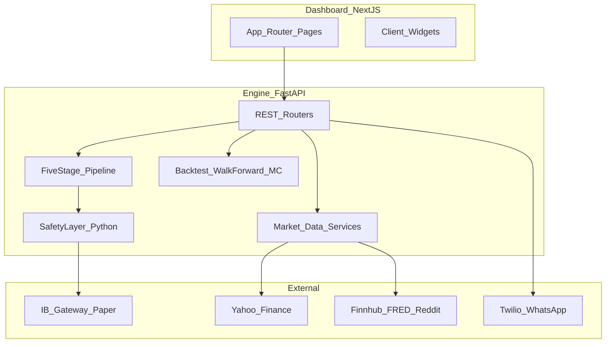

# JARVIS TRADER — Unified Canon

**Version:** 1.0.0  
**Last updated:** 2026-03-30  
**Repository:** `C:\Users\mattm\ThinkorSwim\jarvis-trader`  
**Engine:** FastAPI — default port **8010**  
**Dashboard:** Next.js — default port **3010**  
**Related unified deployment:** `C:\Users\mattm\master-jarvis` (merged v2 + Trader; port **8009**)

> **Supersession note (2026-09-01):** The active implementation plan and
> governance-reset backlog now live at
> [`docs/plans/master-implementation/README.md`](plans/master-implementation/README.md).
> This canon remains historical architectural context until it is reconciled
> against the master implementation package.

This document is the **single canonical narrative** for JARVIS Trader. All merged sources are traced in [Appendix A](#appendix-a-source-map--completeness-checklist). Machine-readable provenance: [CANON_SOURCE_MAP.json](./CANON_SOURCE_MAP.json).

---

## 1. Canon policy

### 1.1 Definitions

| Term | Meaning |
|------|---------|
| **Canon** | This file + `CANON_SOURCE_MAP.json`; overrides ad-hoc chat when they conflict. |
| **Silent supersession** | Forbidden. If a metric or rule changes, the Research Truth Ledger (§11) gets a new row; old rows are marked `superseded`, not deleted. |
| **Trusted** | Claim is consistent with post-fix backtester / walk-forward methodology documented in project memory and research reports. |
| **UI-only** | Hardcoded dashboard or marketing benchmark — **not** valid for risk or capital decisions until aligned with §11. |

### 1.2 Update protocol

1. Change engine, dashboard, or research → update **source repo files** first.  
2. Update §11 if any performance, WFE, or threshold claim moves.  
3. Regenerate `CANON_SOURCE_MAP.json` (checksums + section map).  
4. Append pointer date to project `MEMORY.md` (canonical path + citation rule).

### 1.3 Merge gate (documentation swarm)

**Lane E (Research accountant)** must sign off before any headline performance number appears in executive summaries, slide decks, or dashboard defaults. Until aligned, benchmarks stay labeled **UI-only** (see §11.3).

---

## 2. Executive snapshot

### 2.1 What this system is

JARVIS Trader is an **AI-assisted trading stack**: multi-agent LLM **pipeline** for analysis and debate, **pure-Python safety layer** for enforcement, **backtest / walk-forward / Monte Carlo** tooling, **ThinkorSwim-aligned** indicators, and a **Next.js dashboard** for monitoring, validation, and paper trading.

### 2.2 Current phase

**Paper trading validation** (targets and thresholds are operational goals, not guarantees of edge). Live trading remains **gated** by config (`LIVE_TRADING_ENABLED`, human approval, kill switch).

### 2.3 Ports and entrypoints

| Surface | Path / URL |
|---------|------------|
| Engine API | `http://localhost:8010` (`/docs`, `/health`) |
| Dashboard | `http://localhost:3010` |
| Master-JARVIS (optional unified app) | `http://localhost:8009` — see §12 |

### 2.4 Performance and edge (explicit)

**No unqualified performance claims in this snapshot.** Strategy edge is **instrument-specific**, **timeframe-specific**, and **non-stationary**. All numeric claims live in **§11 Research Truth Ledger** with status `trusted`, `superseded`, or `ui_only`.

---

## 3. Identity and scope boundaries

### 3.1 Three related “JARVIS” systems

| System | Role | Typical root |
|--------|------|--------------|
| **JARVIS v2** | Business intelligence (GMS, Paradigm, ops) | `personal_agent/` (port **8009** in v2-only deployments) |
| **JARVIS Trader** | Trading intelligence (this repo) | `jarvis-trader/` (port **8010**) |
| **Master-JARVIS** | Unified FastAPI: domain-prefixed routes merging v2 + Trader | `master-jarvis/` |

This **canon** is authoritative for **jarvis-trader**. Master-JARVIS content is **summarized** in §12; file paths there use `app/` — this repo uses `engine/` for the trading domain until you deploy only master-jarvis.

### 3.2 Comparative analysis (v2 vs Trader)

A standalone HTML report compares ecosystems (agents, APIs, risk, integrations):  
`C:\Users\mattm\Greenfield Metal Sales\dev\personal_agent\JARVIS_v2_vs_TRADER_Analysis.html`  
Plan reference: `C:\Users\mattm\.claude\plans\zany-frolicking-allen.md`  

**Canon use:** cite for **strategic** positioning only — not for Trader execution parameters.

### 3.3 Strategic pivot (operator context)

Trader work was explicitly prioritized over GMS operations for the 2026-03-30 arc; daily standing procedures for trading are centralized in `TRADING_DAILY_ROUTINE.md` (ingested; see §9).

### 3.4 Options vs futures (coverage honesty)

- **Futures-first:** MES, MNQ, MCL, MGC, continuous ES/NQ via Yahoo mapping — documented in data loader, paper setup, and watchlists.  
- **Options:** Watchlist symbols (e.g. SPY, QQQ) appear in pipeline and analysis; **detailed options playbook (Greeks, assignment, rolls)** is a **known gap** — track as explicit backlog; do not assume parity with futures coverage.

---

## 4. Architecture (merged)

### 4.1 Logical architecture

### 4.2 Jarvis-trader layout (authoritative)

| Area | Path | Notes |
|------|------|--------|
| API entry | `engine/main.py` | Routers mounted; port 8010 |
| Agents | `engine/agents/` | Pipeline stages; schemas |
| Risk | `engine/risk/` | Safety layer, loss tracker, PnL monitor |
| Backtest | `engine/backtest/` | Signals, indicators, walk_forward, monte_carlo |
| Rules (LLM context) | `engine/agents/rules/trading_rules.md` | 5-layer framework |
| ThinkScript sources | `thinkorswim-scripts/` | `.ts` studies + `INTEGRATION_GUIDE.md` |
| Dashboard | `dashboard/app/` | One `page.tsx` per route |
| Infra | `infrastructure/docker-compose.yml` | Postgres, Redis, QuestDB, Grafana (optional) |

### 4.3 Master-JARVIS layout (reference)

Copied trading domain mirrors `engine/` → `app/` with routers split from monolith (`master-jarvis/docs/MIGRATION_LOG.md`). **Endpoint count** in migration doc (26) is **stale vs** jarvis-trader registry (**82+** REST in `ENDPOINT_REGISTRY.md`) — treat **this repo’s registry + OpenAPI** as current for Trader.

---

## 5. Strategy stack

### 5.1 Core idea

- **STC (Schaff Trend Cycle)** for timing; **ATR (Wilder)** for stop/target scaffolding; **multi-layer regime / structure / bias / entry** stack per `trading_rules.md` and `signals.py`.  
- **Per-instrument parameter tuples** (`INSTRUMENT_PARAMS`) and optional **adaptive regime**, **volume**, **MTF** filters — see MEMORY and walk-forward docs for **which filters are approved per symbol**.

### 5.2 Documented disagreements (resolved in canon)

| Topic | Source A | Source B | Canon resolution |
|-------|----------|----------|------------------|
| MES 1h “headline” PF / Sharpe | `JARVIS_TRADER_MASTER_REPORT_2026-03-30.md`, Session 5 `BacktestCompareWidget` | `MEMORY.md` v2.7 WFE + bugfix narrative | **§11:** old headline = `ui_only` / `superseded`; research decisions use **WFE + post-fix** rows. |
| STC OS/OB defaults | older SUMMARY (23/83 daily); INTEGRATION_GUIDE (15/83 1h) | MEMORY per-instrument tuples | **Canonical params:** `MEMORY.md` + `signals.py` for live code; TOS must match INTEGRATION_GUIDE table when visual parity needed. |
| Active instruments | MEMORY/v2.7 “MCL/MNQ APPROVED” | Tier-3 flip 2026-05-24 (`engine/CLAUDE.md`) | **Canon:** §11 + `engine/CLAUDE.md` — as of 2026-05-24, **MES 1h** and **MGC 1h** are the active paper symbols (p_edge gate v2); **MCL/MNQ halted** (`DO_NOT_TRADE`), **M2K rejected**. The earlier v2.7 MCL/MNQ approval is superseded. |

### 5.3 Instruments and walk-forward ethos

- Walk-forward efficiency (WFE) and **optimizer kwargs bug** (silent `None` returns) are documented in `MEMORY.md` and `engine/docs/BACKTEST_RESEARCH_REPORT.md`.  
- **Do not** quote in-sample PF without **OOS / WFE** context for the same code revision.

---

## 6. ThinkScript corpus (canonical)

### 6.1 Inventory rule

- **34** `.ts` files on disk → **21 unique studies** (13 are TOS `shared_` export duplicates). Authority: `TOS_SCRIPT_ANALYSIS.md` + `thinkorswim-scripts/INTEGRATION_GUIDE.md`.

### 6.2 Canonical unique studies × layer × Python

| Layer | Unique scripts (representative file) | Python alignment |
|-------|----------------------------------------|------------------|
| L1 Regime | `Saty_ATR_LevelsSTUDY.ts`, `Saty_Phase_OscillatorSTUDY.ts`, `shared_mtftrendbarSTUDY.ts` | `indicators.py`: ATR consumed, phase, ribbon; `regime.py` / classifier |
| L2 Structure | `AA_CoreyTPOProfilev1STUDY.ts`, `AA_CoreyTscorev2STUDY.ts`, `AA_CoreyIBv1STUDY.ts`, `AA_CoreyRFv2STUDY.ts`, `AA_CoreySFv2STUDY.ts`, `AA_CoreyGapfinderv1STUDY.ts` | `signals.py` structure / IB / profile logic |
| L3 Bias | `NextSignalMomentumSTUDY.ts`, `Saty_Volume_StackSTUDY.ts`, `shared_OB_STYLE_CYCLE_TIMESHIFT_PAINT_BARSSTUDY.ts` | `kama()`, volume stack, `stc()` |
| L4 Entry | STC + IB + Keltner / OB Omega family | `layer4_entry`, Keltner in indicators |
| L5 Risk / targets | `Saty_ATR_LevelsSTUDY.ts` (+ shared duplicate) | Stop/target ATR multiples in backtester |
| Supporting | `TRIN_ChetanSTUDY.ts`, `GAPS_Chetan1STUDY.ts`, legacy Corey mobile, dated `ThinkScript_study_*` | TRIN / gaps in rules; utilities reviewed as needed |

**Parameter parity:** STC / ATR / ribbon inputs must match §2 of `INTEGRATION_GUIDE.md` for TOS ↔ engine visual agreement (note 1h vs daily OS overrides).

### 6.3 Gap

Full literal ThinkScript source is **not** inlined here — see files in `thinkorswim-scripts/` and the 1,100+ line narrative in `TOS_SCRIPT_ANALYSIS.md`.

---

## 7. LLM agent pipeline

### 7.1 Stages (jarvis-trader)

1. **Analysis (parallel):** Technical, News, Social, Fundamental  
2. **Debate:** Bull, Bear → Debate orchestrator  
3. **Decision:** Trader  
4. **Risk:** Risk manager (LLM advisory) **after** Python `SafetyLayer` hard checks  
5. **Fund:** Fund manager (final gate, human approval flags)

### 7.2 Models (typical; verify in agent modules / env)

| Agent class | Typical model tier |
|-------------|---------------------|
| Technical / Debate / Trader / Risk / Fund | Higher tier (e.g. Opus-class) |
| News / Fundamental / Bull / Bear | Mid tier (e.g. Sonnet-class) |
| Social | Lighter / higher-frequency tier |

### 7.3 Failure modes

- Upstream API outage (Finnhub, broker, Yahoo) → degraded pipeline; safety may block submission.  
- Partial JSON / timeout → `errors` array in pipeline response; dashboard should surface.

### 7.4 Master-JARVIS variant

`master-jarvis/docs/TRADING_SYSTEM.md` describes the same logical pipeline with `app/agents/trade/` paths and example endpoint `POST /trade/pipeline/run` — **prefix and path may differ** from this repo’s `/pipeline/run`; normalize in API gateway or client config.

---

## 8. Risk, compliance, and security

### 8.1 Sacred layer

- **Pure Python** `SafetyLayer`: kill switch, daily loss, drawdown, order limits — **no LLM bypass**.  
- Consecutive loss tracker and PnL monitor modulate or halt trading per config.

### 8.2 Kill switch and circuit breakers

- Manual + automatic triggers (daily loss, max drawdown, broker disconnect patterns — see `risk/safety_layer.py` and `SECURITY_REMEDIATION.md`).

### 8.3 Standing orders and audits

- Operator rules appear across `MEMORY.md`, session logs, and `master-jarvis/docs/STANDING_ORDERS_AUDIT.md`.  
- **5 parallel agents / hot-spare** documentation norm: see §12.1 protocol (matches MEMORY standing orders).

### 8.4 Security remediation

- Credential handling, Twilio, API keys: follow `SECURITY_REMEDIATION.md` and `.gitignore` patterns (no OAuth client JSON in repo).

---

## 9. Operations

### 9.1 Daily routine

- **Single SOP:** `TRADING_DAILY_ROUTINE.md` (pre-market through post-close, API checklists, escalation).

### 9.2 Paper trading

- `PAPER_TRADING_RUNBOOK.md`, `PAPER_TRADING_APPROVAL.md`, `engine/docs/PAPER_TRADING_GUIDE.md`, `engine/paper/MNQ_paper_setup.md`, `engine/paper/MCL_paper_setup.md`.

### 9.3 Monitoring

- `infrastructure/MONITORING.md`, `PROMETHEUS_SETUP_SUMMARY.md`, health pages on dashboard.

### 9.4 Walk-forward and research ops

- `engine/WALK_FORWARD_GUIDE.md`, `WALK_FORWARD_IMPLEMENTATION_SUMMARY.md`, `REGIME_ANALYSIS_README.md`, `CONSECUTIVE_LOSS_IMPLEMENTATION_SUMMARY.md`.

---

## 10. API surface and dashboard information architecture

### 10.1 API authority

- **Primary registry:** [ENDPOINT_REGISTRY.md](../ENDPOINT_REGISTRY.md) (82+ REST groups; WebSocket section).  
- **Validation log:** `JARVIS_TRADER_API_VALIDATION_2026-03-30.md`, `INTEGRATION_VERIFICATION.md`.  
- Treat **OpenAPI** at `/openapi.json` as runtime truth when docs drift.

### 10.2 Dashboard routes (all `page.tsx`)

| Route | Primary widgets / panels | Primary endpoints (typical) | Risk / trading relevance |
|-------|---------------------------|-----------------------------|---------------------------|
| `/` | KillSwitch, PositionsPanel, AgentFeed, SentimentPanel, PerformancePanel, WatchlistBar, PaperTradingPanel, TradeHistory, DailyPnlPanel, RegimeDisplay, MTFConfirmationWidget, SignalHistory, CircuitBreakerPanel, IBGatewayStatus, StrategyParamsPanel, SessionTodayWidget | `/health`, `/portfolio/*`, `/pipeline/*`, `/safety/*`, `/prices/*` | **Command center** |
| `/analysis` | Inline pipeline runner (all stages expandable) | `POST /pipeline/run` | Full agent trace |
| `/paper` | OpenPositions, RiskStatus, CircuitBreaker, signals, regime, decisions, sizing | Paper portfolio, safety | Paper validation |
| `/performance` | ROI, calendars, equity, drawdown chart, win rate by symbol, trades, duration, commissions | `/portfolio/history/trades`, `/analytics/*` | Performance QA |
| `/scorecard` | Readiness, rolling performance, paper balance, backtest compare, drawdown, equity | `/analytics/performance`, benchmarks | **Contains UI-only benchmarks** — §11 |
| `/validation` | Pipeline history, sizing, reconciliation, export, checklist, go-live | Mixed validation | Go-live gating |
| `/health` | PreFlight, AgentPipeline, alerts, DB stats, uptime, IB | `/system/preflight`, `/alerts/*`, `/health` | Ops |
| `/settings` | Risk settings, WhatsApp, position sizer, config display | `/safety/config`, `/notifications/*`, `/paper/mes-signal` | Config |
| `/watchlist` | Watchlist scan, signals, VIX, session, symbol performance | `/watchlist`, `/prices/*`, pipeline | Scanning |
| `/journal` | Today session, journal stats, pipeline decisions, trades | Trades + decisions | Journal |
| `/backtest` | Comparison, params, signal accuracy | `/backtest/*` or local | Research |
| `/stats` | Placeholder | — | **Gap:** “coming soon” |

### 10.3 Session 5 hardcoded UI thresholds (must align with §11)

| Location | Constant | Purpose |
|----------|----------|---------|
| `LiveReadinessWidget` | PF ≥ 2.0, Sharpe ≥ 1.5, WR ≥ 55%, trades ≥ 60, days ≥ 30, DD ≤ 15% | Paper graduation **targets** |
| `BacktestCompareWidget` | MES 1h PF 5.27, Sharpe 4.16, etc. | **UI-only legacy benchmark** until replaced |

### 10.4 Failure modes (dashboard)

- 404 on `/alerts/active` → widgets fall back per Session 5 log.  
- `/pipeline/status` missing → fallback `/health`.  
- Wrapper vs array JSON for trades — clients normalize `{trades:[]}` vs `[]`.

---

## 11. Research truth ledger

### 11.1 Rules

- **trusted_research:** Uses post-fix backtester logic; cited in `MEMORY.md` v2.7+ or `BACKTEST_RESEARCH_REPORT.md`.  
- **superseded:** Older methodology (look-ahead, partial exits, optimizer kwarg bug).  
- **ui_only:** Hardcoded widget / report headline without matching ledger proof.

### 11.2 Critical findings (v2.7 excerpt — canonical approvals)

| Instrument | Timeframe | Metric | Value | Status | Note |
|-----------|-----------|--------|-------|--------|------|
| MES | 1h | p_edge | **0.75** | trusted_research | Paper **APPROVED** (Tier-3 2026-05-24); SMA(60,200) trend, atr_trail_mult=2.0; ALT gate v2 PASS. Supersedes prior 1h WFE=0.09. |
| MGC | 1h | p_edge | **0.6842** | trusted_research | Paper **APPROVED** (Tier-3 2026-05-24); SMA(50,120) trend, atr_trail_mult=2.0; ALT gate v2 PASS. Supersedes prior 1d WFE=0.14. |
| MCL | 1h | WFE | **0.82** | trusted_research | **HALTED** — `DO_NOT_TRADE`; hypotheses A–E exhausted 2026-05-07 |
| MNQ | 1h | WFE | **0.57** | trusted_research | **HALTED** — `DO_NOT_TRADE`; trend/breakout/ORB all fail gate v2 |
| M2K | 1h | — | — | trusted_research | **REJECTED** — SMA/ORB/Donchian rank-1 all FAIL 2026-05-24 |
| SPY | 1h | WFE | negative / TBD | trusted_research | Not cleared (see MEMORY) |

### 11.3 Conflicting headline claims (must not drive risk)

| ID | Claim | Source | Status | Resolution |
|----|-------|--------|--------|------------|
| RT-UI-001 | MES 1h PF **5.27**, Sharpe **4.16**, WR **72%**, 312 trades | Master Report 2026-03-30, `BacktestCompareWidget`, Session 5 log | **ui_only** | Superseded by bugfix + WFE narrative; replace widget defaults when §11.2 values available for display. |
| RT-HIST-001 | “All five instruments fail walk-forward” (table WFE -1.11 …) | `MEMORY.md` older subsection | **superseded** | Superseded by **v2.7 Critical Findings** for instrument-specific approval; keep as history only. |
| RT-PR-001 | Various US-* completion notes in `engine/prd.json` | PRD | **mixed** | Verify against git + JSON results under `engine/backtest/results/`; PRD may lag code. |

### 11.4 Known methodology fixes (always cite when comparing to pre-2026-03-30 PDFs)

- Look-ahead bias in signal bar usage  
- Partial stop fills overstating P&L  
- T1 ATR multiple unrealistically wide for intraday (shift toward **1.00** ATR context per MEMORY)  
- Optimizer kwargs passed through to signal generation caused **silent None** returns — fixed by filtering kwargs  
- Commission modeling: verify round-trip application in `backtester.py` (MEMORY: verified)

### 11.5 Ongoing validation targets (operational, not edge claims)

| Metric | Target | Where enforced |
|--------|--------|----------------|
| Profit factor | ≥ 2.0 | `LiveReadinessWidget` |
| Sharpe | ≥ 1.5 | idem |
| Win rate | ≥ 55% | idem |
| Trades | ≥ 60 | idem |
| Trading days | ≥ 30 | idem |
| Max drawdown | ≤ 15% | idem |

These are **process gates** for paper graduation — not proof of alpha.

---

## 12. Migration, roadmap, and execution protocol

### 12.1 Five-agent documentation / delivery swarm

| Lane | Responsibility | Hot-spare |
|------|----------------|-----------|
| A | Corpus audit — file checklist, missing paths | Spawn on read failures |
| B | ThinkScript cartographer — 21 unique studies, layer map | Spawn on count mismatch |
| C | Dashboard + API matrix — OpenAPI vs registry | Spawn on drift |
| D | Risk + ops merge — single threshold source | Spawn on contradiction |
| E | Research accountant — §11 ledger owner | **Merge gate** for metrics |

### 12.2 Master-JARVIS migration (summary)

- **Source:** `MIGRATION_LOG.md` — Phases 0–1 complete: risk, backtest, agents, routers, services, ThinkScript copy to unified tree.  
- **Gap:** “Migration complete, **untested**” — run full integration smoke on **8009** before deprecating standalone 8010 if unified.  
- **Path drift:** Trader docs say `POST /pipeline/run`; master doc example `POST /trade/pipeline/run` — normalize in deployment.

### 12.3 Federated plan priorities (SQLite / IB / paper)

From `federated-fluttering-brook.md`: SQLite persistence, IB Gateway paper, circuit breakers on live state, position sizing — **reconcile** against current repo (`ENDPOINT_REGISTRY`, `portfolio/`, migrations). Many items **already advanced** per Session logs; ledger should track **residual** gaps via issues, not duplicate prose here.

### 12.4 Secrets

- **Excluded from canon body:** `harmonic-knitting-sphinx.md` (Brave API key plan) — do not paste keys; rotate if ever committed.

---

## Appendix A — Source map / completeness checklist

**Verification run:** 2026-03-30 — all listed **tier-1** paths returned `True` on Windows `Test-Path` (repo + `master-jarvis/docs` + comparative HTML).

### A.1 Jarvis-trader — tier 1

| File | Canon sections |
|------|----------------|
| `JARVIS_TRADER_SESSION_LOG_2026-03-30.md` | §3, §9, §12 |
| `jarvis-trader-dashboard-session5-log.md` | §10, §11.3 |
| `Jarvis_Trader_Agent_Master_Claude_Code_Session.md` | §7, §12 |
| `jarvis-trader-skill-project-log.md` | §12 |
| `SESSION_NOTES_ARCHIVE.md` | §9, §12 |
| `engine/docs/jarvis-trader-session-log-2026-03-28.md` | §9, §12 |
| `JARVIS_TRADER_MASTER_REPORT_2026-03-30.md` | §4, §10, §11.3 (contrast) |
| `JARVIS_TRADER_API_VALIDATION_2026-03-30.md` | §10 |
| `COMPREHENSIVE_VERIFICATION_REPORT.md` | §4, §10 |
| `DELIVERABLES.md` | §12 |
| `TEST_RESULTS.md` | §8, §12 |
| `TRADING_DAILY_ROUTINE.md` | §9 |
| `SECURITY_REMEDIATION.md` | §8 |
| `CONSECUTIVE_LOSS_IMPLEMENTATION_SUMMARY.md` | §8, §9 |
| `TOS_SCRIPT_ANALYSIS.md` | §6 |
| `thinkorswim-scripts/INTEGRATION_GUIDE.md` | §5, §6 |
| `engine/agents/rules/trading_rules.md` | §5, §6, §7 |
| `engine/docs/BACKTEST_RESEARCH_REPORT.md` | §5, §11 |
| `engine/backtest/results/EXECUTIVE_BRIEFING.md` | §11 |
| `engine/backtest/results/SUMMARY.md` | §5, §11 |
| `README.md` | §2, §4 |
| `SUMMARY.md` (root) | §5, §11 |
| `CHANGELOG.md` | §12 |
| `ENDPOINT_REGISTRY.md` | §10 |
| `INTEGRATION_VERIFICATION.md` | §10 |
| `PAPER_TRADING_RUNBOOK.md` | §9 |
| `PAPER_TRADING_APPROVAL.md` | §9 |
| `REGIME_ANALYSIS_README.md` | §9, §11 |
| `engine/WALK_FORWARD_GUIDE.md` | §9, §11 |
| `WALK_FORWARD_IMPLEMENTATION_SUMMARY.md` | §9, §11 |
| `engine/paper/MNQ_paper_setup.md` | §9 |
| `engine/paper/MCL_paper_setup.md` | §9 |
| `engine/prd.json` | §11.3 |

### A.2 External — tier 1

| File | Canon sections |
|------|----------------|
| `C:\Users\mattm\master-jarvis\docs\SESSION_REPORT.md` | §12 |
| `...\ARCHITECTURE.md` | §3, §4, §12 |
| `...\TRADING_SYSTEM.md` | §4, §7, §12 |
| `...\MIGRATION_LOG.md` | §4, §12 |
| `...\STANDING_ORDERS_AUDIT.md` | §8 |
| `...\personal_agent\JARVIS_v2_vs_TRADER_Analysis.html` | §3 |
| `C:\Users\mattm\.claude\plans\zany-frolicking-allen.md` | §3 |
| `C:\Users\mattm\.claude\plans\federated-fluttering-brook.md` | §12.3 |
| `C:\Users\mattm\.claude\plans\snoopy-hugging-pnueli.md` | §12 (doc targets) |

### A.3 Memory (project)

| File | Canon sections |
|------|----------------|
| `C:\Users\mattm\.claude\projects\C--Users-mattm-ThinkorSwim-jarvis-trader\memory\MEMORY.md` | §5, §11, §12 |

### A.4 Explicit non-ingestion

| File | Reason |
|------|--------|
| `harmonic-knitting-sphinx.md` | Contains third-party API key material — pointer only §12.4 |

---

## Appendix B — Inventory verification note

Automated path checks (2026-03-30) confirmed existence of every **tier-1** path in §A.1–A.3. If a file moves, update `CANON_SOURCE_MAP.json` and this appendix.

---

*End of Unified Canon v1.0.0*
