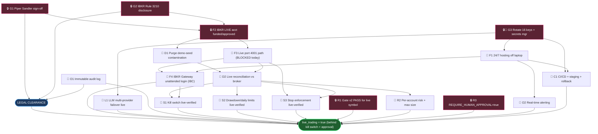

# LIVE_TRADING_READINESS — dependency graph & sequenced path to `live_trading=true`

**Living doc.** Update the status markers as gates clear. Last revised: 2026-06-04.

> **Supersession note (2026-09-01):** Live-trading gates remain binding, but the
> active JARVIS implementation plan, backlog, and governance reset are tracked in
> [`docs/plans/master-implementation/README.md`](plans/master-implementation/README.md).
> Reconcile this readiness graph before relying on older status markers.

## Purpose

`live_trading=true` is gated on **legal clearance AND a proven-safe technical state** —
both must be green. This doc is the canonical dependency graph and the sequenced plan
that gets us there. It supersedes ad-hoc "are we ready to go live?" discussions.

**Current baseline (2026-06-04):** paper-only (`live_trading=false`, `paper_mode=true`),
running on a personal Windows laptop via pm2 bound to localhost, IBKR **paper** (port 4002);
IBKR **live** (port 4001) is a hard "permanently blocked" network policy; git is local-only
(nothing pushed). The dashboard/engine honesty+safety integrity loop (US-001..010, 8/10) is
live on `master` (`b636eed`) and verified — in **paper**.

> **Scope note.** This graph is for **(A) Amo's own live account**. **(B) offering it to
> end users** adds an RIA/regulatory super-gate *above* G1 that gates the entire diagram
> (securities/compliance counsel required first). The legal nodes below reflect Amo's stated
> compliance constraints, not legal advice — confirm specifics with counsel `[UNVERIFIED]`.

## Legend

`🔒` human/legal gate (no code substitutes) · `🔧` engineering · `✅` done · `🟡` partial · `⬜` not started

## Dependency graph (ASCII)

```
══ TIER 0 ─ HARD GATES (block everything below) ════════════════════════════
  [G1] 🔒⬜ Piper Sandler personal-trading sign-off (automated/algo)
  [G2] 🔒⬜ IBKR Rule 3210 disclosure acknowledged
  [G3] 🔒🔧⬜ Rotate 16 leaked keys (git history) + secrets manager
        G1 + G2 ──────────────────────────────►( LEGAL CLEARANCE )
        G3 ───────────────────────────────────►(prereq for ANY live/internet exposure)

══ TIER 1 ─ FOUNDATIONS ════════════════════════════════════════════════════
  [F1] 🔧⬜ 24/7 hosting off the laptop (server + supervisor)        ◄── G3
  [F2] 🔒⬜ IBKR LIVE account funded + futures-approved              ◄── G1,G2
  [F3] 🔧⬜ IBKR live port 4001 path resolved (today: BLOCKED)       ◄── F2
  [F4] 🔧⬜ IBKR Gateway unattended login (IBC)                      ◄── F1,F3

══ TIER 2 ─ CORRECTNESS PREREQS ════════════════════════════════════════════
  [D1] 🔧⬜ Purge demo-seed contamination (MES 98 / MNQ 47 fakes)    ◄── F2
  [D2] 🔧🟡 Live reconciliation vs broker of record                 ◄── D1,F3
  [L1] 🔧⬜ LLM path resilient — multi-provider failover LIVE        ◄── G3
  [O1] 🔧🟡 Immutable audit log of every decision + order ───────────► also feeds LEGAL

══ TIER 3 ─ PROVEN-SAFE GATES (paper→live verification) ════════════════════
  [S1] 🔧⬜ Kill switch live-verified on real account               ◄── F4,D2
  [S2] 🔧⬜ Drawdown / daily-loss limits live-verified (US-005)      ◄── D2
  [S3] 🔧⬜ Stop enforcement live-verified (PaperStopMonitor→live)   ◄── F3,D2
  [R1] 🔒🟡 Gate v2 PASS for the live symbol(s)  (MES/MGC pass-via-alt; MCL/MNQ blocked)
  [R2] 🔧🟡 Per-account risk limits + hard max position size        ◄── D2
  [R3] 🔒✅ Keep REQUIRE_HUMAN_APPROVAL=true at first  (defense-in-depth)

══ TIER 4 ─ OPERABILITY ════════════════════════════════════════════════════
  [O2] 🔧🟡 Real-time alerting (engine/feed/safety down)            ◄── F1
  [C1] 🔧⬜ CI/CD + staging + one-command rollback                  ◄── G3,F1

══ THE FLIP ════════════════════════════════════════════════════════════════
  ( LEGAL CLEARANCE ) + F1..F4 + D1,D2,L1,O1 + S1,S2,S3 + R1,R2,R3 + O2,C1
                                   │
                                   ▼
                    ┌──────────────────────────────┐
                    │   live_trading = true          │
                    │   (STILL behind kill switch +  │
                    │    human approval at first)    │
                    └──────────────────────────────┘
```

## Dependency graph (Mermaid)



## Critical path

`G1 → F2 → F3/F4 → D1 → D2 → S1/S2/S3 → GO`

The bottleneck is the **legal sign-off (G1)** plus the **IBKR live broker path (F2→F3)**.
F3 is not a toggle: port 4001 is a deliberate "permanently blocked" network policy that must
be consciously opened and secured. Nothing technical shortens the *legal* critical path —
flipping the bit before G1 clears would be trading illegally.

## Sequenced plan (phased; tracks that run in parallel)

### Phase 0 — Engineering hardening (NO legal dependency; start immediately, parallel)
These make the eventual flip far faster and are safe to do now while legal is in flight.

- [ ] **G3** Rotate all 16 leaked credentials (per `~/.claude/hygiene-reports/REVOKE-CHECKLIST-2026-06-01.md`); move to 1Password/KMS; purge git history. *Blocks any internet exposure.*
- [ ] **F1** Stand up a 24/7 host (cloud VM/VPS) with engine + dashboard + IBKR Gateway under a real supervisor.
- [ ] **L1** Land the multi-provider LLM failover on master (the Vertex work, done deliberately *after* the peer reconciles `engine/llm/client.py`); add per-call cost caps. *Removes the Anthropic-credit single point of failure that degraded the path this session.*
- [ ] **O1** Immutable audit log of every decision + order (also a compliance dependency).
- [ ] **O2** Real-time alerting on engine/feed/safety-control failure (beyond manual `/health`).
- [ ] **C1** Remote + CI (wire existing pytest + tsc gates) + staging + one-command rollback.

### Phase 1 — Legal + broker path (CRITICAL PATH; Amo + counsel + IBKR)
- [ ] **G1** Piper Sandler personal-trading sign-off for automated/algorithmic trading.
- [ ] **G2** IBKR Rule 3210 disclosure acknowledged.
- [ ] **F2** Fund + get futures approval on the IBKR **live** account.
- [ ] **F3** Resolve + secure the IBKR live (4001) network path.
- [ ] **F4** IBKR Gateway unattended login (IBC) for the live account.
- [ ] **R1** Confirm Gate v2 PASS for the exact symbol(s) to trade live (MES/MGC currently pass-via-alt; MCL/MNQ blocked — do not trade blocked symbols).

### Phase 2 — Data correctness (after F2/F3)
- [ ] **D1** Purge demo-seed contamination from the live-designated account (no MES 98 / MNQ 47 phantoms).
- [ ] **D2** Continuous live reconciliation against the broker of record.

### Phase 3 — Prove safety on live, money-at-risk minimal (after D2)
- [ ] **R2** Per-account risk limits + hard max position size (a bug must not be able to size a catastrophic order).
- [ ] **S1** Kill switch live-verified on the real account.
- [ ] **S2** Drawdown / daily-loss limits live-verified (US-005 equity-peak, on clean data).
- [ ] **S3** Stop enforcement live-verified (PaperStopMonitor → live order path).
- [ ] Safety-layer rule: **block trading when `llm_path_healthy=false`** (decisions depend on the LLM path).

### Phase 4 — The flip (staged ramp)
- [ ] **R3** Confirm `REQUIRE_HUMAN_APPROVAL=true` (defense-in-depth, keep on at first).
- [ ] Flip `live_trading=true` with a **capital ramp**: 1 micro contract → monitor several full cycles → scale only after S1–S3 hold live.
- [ ] Kill switch remains the always-available abort.

## Key structural edges (why the graph is shaped this way)

- **D2 → S1/S2/S3** — safety controls *read* account data; they can't be trusted until the books are clean and reconciled (US-005's whole point: a demo-inflated peak gives a false halt or masks a real breach).
- **O1 → LEGAL** — audit logging is a likely compliance *requirement*, not a nice-to-have, so it gates the legal node.
- **L1 feeds safety implicitly** — trade decisions depend on the LLM path, so a resilient LLM path is a precondition for unattended live operation.

## Cross-references

- `~/.claude/rules/jarvis-trader.md` — gate v2 thresholds, DO_NOT_TRADE_SYMBOLS, restart/health gates
- `~/.claude/rules/verification.md` — health-gate sequence
- `~/.claude/hygiene-reports/REVOKE-CHECKLIST-2026-06-01.md` — the 16 keys (G3)
- ralph project `~/.claude/skills/ralph/projects/jarvis-dashboard-integrity-2026-06-03/` — the paper integrity loop already shipped
