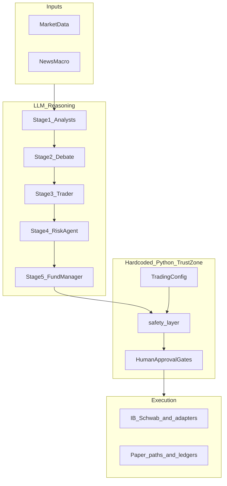
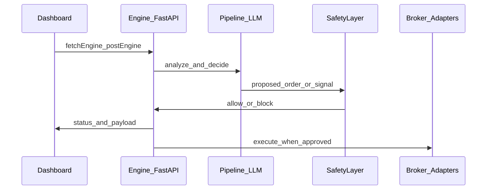

# System map

**Audience:** Engineers and technical operators.  
**Companion:** [engine/main.py](../../engine/main.py), [engine/agents/pipeline.py](../../engine/agents/pipeline.py), [dashboard/lib/api.ts](../../dashboard/lib/api.ts).

---

## 1. Runtime topology

| Process | Port | Responsibility |
|---------|------|------------------|
| Engine (FastAPI / uvicorn) | 8010 | API, pipeline, safety, execution adapters, schedulers |
| Dashboard (Next.js) | 3010 | UI; all engine calls via `fetchEngine` / `postEngine` |
| IB Gateway (paper) | 4002 | Broker paper session (live 4001 blocked per project policy) |
| Supporting infra | varies | PostgreSQL, Redis, QuestDB, Prometheus, Grafana per [CURRENT_STATE.md](../CURRENT_STATE.md) |

---

## 2. Request and control planes

- **REST:** Broad surface mounted from `engine/main.py` (many `include_router` mounts) plus routes organized under [engine/routers/](../../engine/routers/). Exact counts drift; verify via [METRICS_SNAPSHOT.json](METRICS_SNAPSHOT.json) or `scripts/strategic_snapshot.py`.
- **WebSocket:** Real-time events — see [docs/architecture/WEBSOCKET.md](../architecture/WEBSOCKET.md).
- **Dashboard:** App Router pages under [dashboard/app/](../../dashboard/app/); shared API client [dashboard/lib/api.ts](../../dashboard/lib/api.ts).

---

## 3. Five-stage pipeline (logical)

Canonical orchestration: [engine/agents/pipeline.py](../../engine/agents/pipeline.py).

| Stage | Role | Typical agents |
|-------|------|----------------|
| 1 | Parallel analysis | Technical, fundamental, sentiment/social variants |
| 2 | Debate | Bull / bear / orchestration |
| 3 | Decision | Trader — structure for trade |
| 4 | Risk | Risk manager — veto power |
| 5 | Approval | Fund manager — final LLM-stage gate |

**After** stage 5, **hardcoded Python** and **human approval** govern whether an order reaches execution.

---

## 4. Trust boundary (non-negotiable)

**Invariant:** No path may **bypass** [engine/risk/safety_layer.py](../../engine/risk/safety_layer.py) or **human approval** for production order submission. LLM agents may recommend; they do not **own** kill switches.

**Tier-3 configuration:** [engine/config.py](../../engine/config.py) (`TradingConfig`), [engine/backtest/signals.py](../../engine/backtest/signals.py) (STC / canonical signal params).

---

## 5. Multi-market and learning (adjacent systems)

| Area | Location | Notes |
|------|----------|--------|
| Multi-market orchestration | [engine/markets/](../../engine/markets/) | Futures, options, crypto modules; not all equally mature — see [03_CAPABILITY_MATRIX.md](03_CAPABILITY_MATRIX.md) |
| Learning loop | [engine/learning/](../../engine/learning/) | Events / feedback / patterns / recommendations — maturity varies |
| Backtest / WFE | [engine/backtest/](../../engine/backtest/) | Research and validation artifacts; gates in [06_VALIDATION_GATES.md](06_VALIDATION_GATES.md) |

---

## 6. Data flow (simplified)

---

## 7. Related diagrams and inventories

- Endpoint inventories (may lag): [docs/architecture/ENDPOINT_REGISTRY.md](../architecture/ENDPOINT_REGISTRY.md), [docs/architecture/API_ENDPOINT_INVENTORY.md](../architecture/API_ENDPOINT_INVENTORY.md).
- Strategy math reference: [docs/strategy/EQUATIONS.md](../strategy/EQUATIONS.md).
