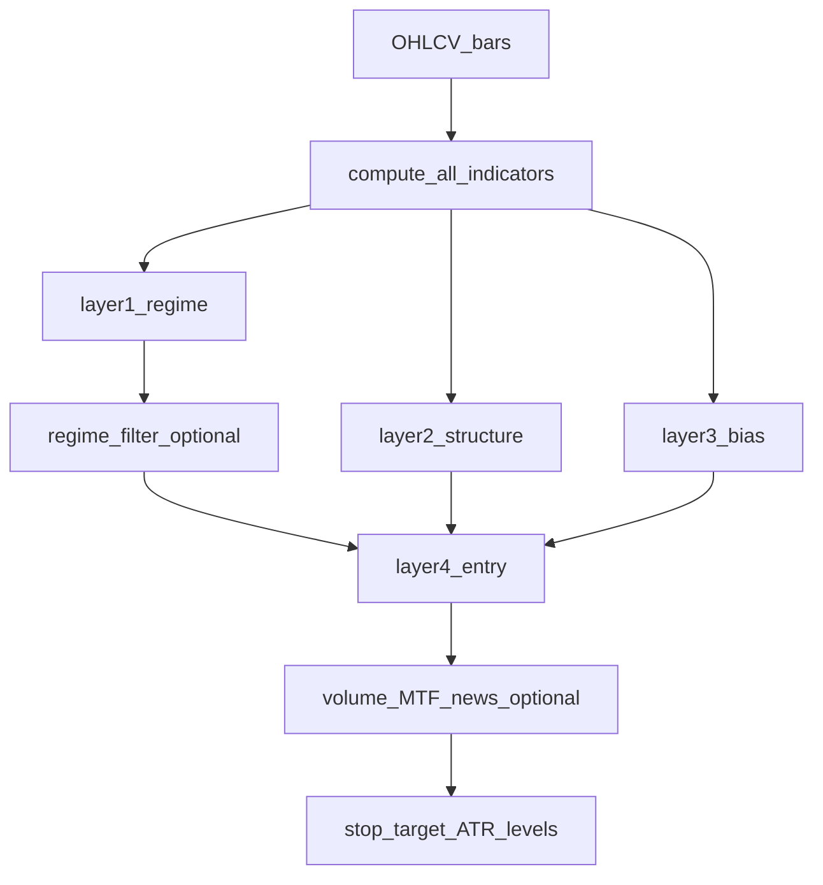

# JARVIS TRADER — Formal trading rules & strategy thesis

**Version:** 1.1  
**Date:** 2026-04-06  
**Canonical code:** [`engine/backtest/signals.py`](../../engine/backtest/signals.py), [`engine/backtest/composite_signals.py`](../../engine/backtest/composite_signals.py), [`engine/config.py`](../../engine/config.py)  
**Math reference:** [EQUATIONS.md](./EQUATIONS.md) — LaTeX-style formulas aligned to those modules.  
**HTML review bundle:** [STRATEGY_CANON_REVIEW.html](./STRATEGY_CANON_REVIEW.html) — browser view of this doc + equations (regenerate: `python scripts/build_strategy_review_html.py`).  
**Next review:** After 30-day paper milestone or any change to `INSTRUMENT_PARAMS` / safety limits.

---

## Table of contents

1. [Entry and exit rules](#1-entry-and-exit-rules)  
2. [Position sizing](#2-position-sizing)  
3. [Regime filters and layer flow](#3-regime-filters-and-layer-flow)  
4. [MCL vs MNQ](#4-mcl-vs-mnq)  
5. [Time-of-day and session policy](#5-time-of-day-and-session-policy)  
6. [Edge thesis and falsifiers](#6-edge-thesis-and-falsifiers)  
7. [Cross-check vs project docs](#7-cross-check-vs-claudemd--project-docs)

---

## 1. Entry and exit rules

### 1.1 Two signal paths (must not be conflated)

| Path | Symbols | Entry function | Role |
|------|---------|----------------|------|
| **Standard 5-layer** | **MCL**, **MNQ**, and every symbol not in `COMPOSITE_INSTRUMENTS` | `generate_signals()` in `signals.py` | Layers 1–4 + per-symbol `INSTRUMENT_PARAMS` for STC OS/OB and ATR multiples |
| **Composite (Cohen-style)** | **`MES` only** (`COMPOSITE_INSTRUMENTS = {"MES"}` as of Sprint 16) | `generate_composite_signals()` in `composite_signals.py` | STC (**gated**) + ORB + VWAP, regime-weighted; **different** stops/targets than pure STC |

Routing: `generate_instrument_signals(df, symbol, **kwargs)` calls composite **only** when `symbol.upper()` is in `COMPOSITE_INSTRUMENTS`; otherwise it calls `generate_signals()`. **Walk-forward validation for approved micros (MCL, MNQ) used the standard path** — composite was removed from those symbols after `exit_date=None` artifacts.

**Downstream usage:** The LLM pipeline’s STC mid-range pre-filter uses `generate_instrument_signals` ([`engine/agents/pipeline.py`](../../engine/agents/pipeline.py)). `TechnicalAnalyst` adds composite **metadata** to the prompt only when the symbol is in `COMPOSITE_INSTRUMENTS` ([`engine/agents/technical_analyst.py`](../../engine/agents/technical_analyst.py)) — today that is **MES only**.

### 1.2 Standard path — every condition that yields `ENTRY_NOW`

All paths require **non-NEUTRAL bias** from `layer3_bias` except where noted. **Regime** is first adjusted by `regime_filter` (see §3).

**A. Exhausted regime**

- If `layer1_regime` is `EXHAUSTED` and `atr_consumed_pct > 90` and phase extended (`phase_val > 61.8` or `< -61.8`): signal `FADE_EXTREME` (not `ENTRY_NOW`).
- Otherwise in `EXHAUSTED`: `NO_TRADE`.

**B. Structure-aligned trend (buy side)**

- `structure_position == BUYER_CONTROL` (above VAH **and** above IB high)
- `bias` in `STRONG_BULL`, `LEAN_BULL`
- `regime == TRENDING_BULL`  
→ `ENTRY_NOW`

**C. Structure-aligned trend (sell side)**

- `structure_position == SELLER_CONTROL` (below VAL **and** below IB low)
- `bias` in `STRONG_BEAR`, `LEAN_BEAR`
- `regime == TRENDING_BEAR`  
→ `ENTRY_NOW`

**D. IB high breakout**

- `above_ib_high` true this bar, `prev_above_ib_high` false (first close above prior bar’s IB high proxy)
- `bias` in `STRONG_BULL`, `LEAN_BULL`  
→ `ENTRY_NOW`

**E. IB low breakdown**

- `below_ib_low` true, `structure_position == SELLER_CONTROL`, bearish bias  
→ `ENTRY_NOW`

**F. STC crossover (classic)**

- Long: `bias` in `STRONG_BULL`, `LEAN_BULL` **and** `stc_cross_up` (cross above oversold threshold).
- Short: `bias` in `STRONG_BEAR`, `LEAN_BEAR` **and** `stc_cross_down` (cross below overbought threshold).  
→ `ENTRY_NOW`

**Other labels (not immediate entries):** `WAIT_FOR_PULLBACK` (STC mid-zone 20–80), `NO_TRADE`, plus post-filters that **replace** `ENTRY_NOW`: `LOW_VOLUME_BLOCK`, `MTF_BLOCKED`, `NEWS_BLACKOUT`.

### 1.3 Composite path — `ENTRY_NOW` conditions

- **Volatile** `regime_type` (from `RegimeClassifier`): no entries; conflicting raw signals become `COMPOSITE_VOLATILE_BLOCK`.
- **STC gate:** `stc_cross_up` / `stc_cross_down` from the STC leg must be true for long/short respectively (`is_long_entry` / `is_short_entry` multiply score by that gate). ORB/VWAP add to `long_score` / `short_score` only — they cannot produce an entry without the STC crossover on that bar.
- **Score:** `long_score` or `short_score` ≥ `entry_threshold` (default **0.35**), using regime weights: TRENDING STC 0.60 / ORB 0.30 / VWAP 0.10; RANGING STC 0.50 / ORB 0.20 / VWAP 0.30.
- **R:R filter:** `composite_rr` must be ≥ **`MIN_RR = 1.2`** (module constant in `composite_signals.py`; the file header comment still mentions 1.5 in one line — **code uses 1.2**).
- Composite sets **its own** stop/target ATR multiples: `COMP_STOP_ATR = 1.00`, `COMP_T1_ATR = 2.50`, `COMP_T2_ATR = 4.00`, `COMP_T3_ATR = 6.00` (not the same as `INSTRUMENT_PARAMS`).
- **STC leg inside composite** calls `generate_signals` with `adaptive_regime=True` and `regime_filter=False`; the ORB submodule is invoked with `volume_filter=True` for its own breakout logic ([`engine/backtest/composite_signals.py`](../../engine/backtest/composite_signals.py)).

### 1.4 Exit mechanics (stops, targets, EOD)

**Standard + composite (column semantics)**

- **Stop:** `stop_level` — long: `close - stop_atr * ATR`; short: `close + stop_atr * ATR` (composite uses fixed 1.0 ATR for its branch as above).
- **Targets:** `target_1`, `target_2`, `target_3` from per-path ATR multiples × ATR — standard path uses `INSTRUMENT_PARAMS`; composite overwrites all three with **2.50 / 4.00 / 6.00** × ATR ([`composite_signals.py`](../../engine/backtest/composite_signals.py)).

**Backtest engine** ([`engine/backtest/backtester.py`](../../engine/backtest/backtester.py)): processes stop/target hits bar-by-bar and **EOD close** at day boundary (`_check_eod_close`).

**Paper runner** ([`engine/backtest/paper_runner.py`](../../engine/backtest/paper_runner.py)): stop checked first; targets **scale out** (≈1/3 at T1, 1/2 of remainder at T2, rest at T3); **breakeven** stop after T1 hit.

**LLM pipeline** ([`engine/agents/pipeline.py`](../../engine/agents/pipeline.py)): does **not** recompute `signals.py` rows; `trade_decision` comes from agents (e.g. Technical analyst may expose `stop_price`, `limit_price`, `target_*`). Quantitative alignment is **best-effort**—operators should treat **`signals.py` + backtest** as canonical for rule formalization, and pipeline output as an overlay that must stay within [`engine/risk/safety_layer.py`](../../engine/risk/safety_layer.py) + `TradingConfig`.

### 1.5 Rules table (template + approved micros + MES composite)

| Item | MNQ (standard) | MCL (standard) | MES (composite via router) |
|------|----------------|----------------|----------------------------|
| **`generate_instrument_signals`** | `generate_signals` | `generate_signals` | `generate_composite_signals` |
| **STC OS / OB** | 15 / 92 | 23 / 83 | STC leg uses symbol params from `INSTRUMENT_PARAMS` / overrides inside composite |
| **Stop (× ATR)** | 0.70 | 0.50 | Composite: **1.00** (fixed `COMP_STOP_ATR`) |
| **T1 / T2 / T3** | 1.00 / 1.80 / 2.618 | 1.00 / 2.618 / 4.00 | Composite: **2.50 / 4.00 / 6.00** (`COMP_T1_ATR` … `COMP_T3_ATR`) |
| **Regime filter (tuple flag)** | True in `INSTRUMENT_PARAMS` | True | MES tuple has **False** for research; composite STC leg still uses `regime_filter=False` + VOLATILE block |
| **Invalidation** | NEUTRAL bias; EXHAUSTED (except fade); optional volume/MTF/news if enabled | Same | Score &lt; threshold, R:R &lt; 1.2, VOLATILE regime, or `COMPOSITE_VOLATILE_BLOCK` |

**Paper runner** ([`paper_config.py`](../../engine/backtest/paper_config.py)) mirrors the approved micro rows: MNQ uses `adaptive_regime=True`; MCL uses static STC params with `adaptive_regime=False`. Neither uses `volume_filter`, `mtf_df`, or `news_blackout` in the default hourly loop ([`paper_runner.py`](../../engine/backtest/paper_runner.py)).

---

## 2. Position sizing

### 2.1 Layer 5 (`compute_position_size`)

**Inputs:** `bias`, `regime` (from **layer1** labels: `TRENDING_BULL`, `TRENDING_BEAR`, `RANGE_BOUND`, etc.), `structure_position` (`BUYER_CONTROL`, `SELLER_CONTROL`, `NEUTRAL_STRUCTURE`, …), `base_risk_pct`.

**Multipliers** (applied to `base_risk_pct`):

| Condition | Multiplier |
|-----------|------------|
| Strong bias + trending + directional structure | `SIZING_FULL` 1.00 |
| Strong bias + trending (any structure) | `SIZING_HIGH` 0.80 |
| Lean bias **or** not trending | `SIZING_HALF` 0.50 |
| Else | `SIZING_MIN` 0.25 |

**Used in:** [`paper_runner`](../../engine/backtest/paper_runner.py) / [`paper_tracker`](../../engine/backtest/paper_tracker.py) for **quantitative** paper paths—not automatically in LLM `final_quantity`.

### 2.2 Hard caps (`TradingConfig` + safety)

From [`engine/config.py`](../../engine/config.py): `MAX_POSITION_SIZE_PCT` (10% of portfolio per position), `MAX_DAILY_LOSS_PCT` (−6% daily halt), `MAX_DRAWDOWN_PCT` (−20% from peak), `MAX_CONTRACTS_PER_INSTRUMENT` (2 micros), `MAX_OVERNIGHT_CONTRACTS`, `MAX_SINGLE_ORDER_VALUE` ($100k), `MAX_MARGIN_UTILIZATION` (40%), `MAX_CORRELATED_EXPOSURE_PCT` (50%), `CONSECUTIVE_LOSS_HALF_SIZE`, `CONSECUTIVE_LOSS_QUARTER_SIZE`, `CONSECUTIVE_LOSS_HALT`, `CONSECUTIVE_LOSS_HALT_HOURS`, `PRICE_COLLAR_PCT`, `MAX_ORDERS_PER_MINUTE`. All values reconciled to `.env` live truth 2026-06-25. **Enforcement** is in the hardcoded safety layer—not LLM.

### 2.3 Pipeline `final_quantity`

[`_resolve_final_action`](../../engine/agents/pipeline.py) takes quantity from **fund manager** (`contracts` / `quantity`) when risk approved; else from **trade decision**; default **0** on hold. So live/paper **LLM path** sizing is **agent-driven**, then clamped by safety. This is **mixed**: quantitative stack has Layer 5; pipeline has discretionary/structured agent output.

### 2.4 Gaps (documentation-only recommendations)

- **Single source of truth:** Either document that operators must align fund-manager contract count with `compute_position_size` output from the same bar, or add a future integration ticket to pass signal-row sizing into the pipeline.
- **Per-symbol max:** `MAX_CONTRACTS_PER_INSTRUMENT` is global—no MCL vs MNQ split in config today.

---

## 3. Regime filters and layer flow

### 3.1 Layer 1 (`layer1_regime`)

**Outputs:** `EXHAUSTED`, `COMPRESSION`, `TRENDING_BULL`, `TRENDING_BEAR`, `RANGE_BOUND`.

**Logic (simplified):** `atr_consumed_pct > 90` → `EXHAUSTED`; compression phase + consumption &lt; 50 → `COMPRESSION`; bullish/bearish EMA trend + consumption &lt; 70 and phase sign → `TRENDING_BULL` / `TRENDING_BEAR`; else `RANGE_BOUND`.

**`regime_filter` in `generate_signals`:** When **False**, `EXHAUSTED` and `COMPRESSION` are **rewritten to `RANGE_BOUND`** before `layer4_entry` (optimizer bypass / composite STC leg). When **True**, regimes are passed through unchanged.

**Important nuance:** `layer4_entry` has **no branch for `COMPRESSION`** — only `EXHAUSTED` is handled explicitly (`FADE_EXTREME` / `NO_TRADE`). So with `regime_filter=True`, **`COMPRESSION` can still yield `ENTRY_NOW`** (e.g. STC crossover + bullish/bearish bias) unless other gates block. The docstring on `generate_signals` that says EXHAUSTED and COMPRESSION “block all entries” when `regime_filter=True` is **stronger than the actual `layer4_entry` logic**; treat **code behavior** as canonical here.

**Per-symbol default:** When `symbol=` is passed and `INSTRUMENT_PARAMS[symbol]` includes the 7-tuple, the tuple’s **7th element** sets `regime_filter` unless the caller overrides it after the merge (see [`generate_signals`](../../engine/backtest/signals.py) around the `inst_regime` assignment).

### 3.2 Layers 2–4 (operator view)

- **Layer 2** `layer2_structure`: auction proxy—VPOC/VAH/VAL/IB high-low from OHLCV; position `BUYER_CONTROL` / `SELLER_CONTROL` / `NEUTRAL_STRUCTURE`.
- **Layer 3** `layer3_bias`: votes across KAMA, STC signal, volume skew, EMA ribbon → `STRONG_*`, `LEAN_*`, `NEUTRAL`.
- **Layer 4** `layer4_entry`: combines regime + bias + structure + STC crosses per §1.2.

### 3.3 Optional gates in `generate_signals`

| Flag | Effect |
|------|--------|
| `adaptive_regime` | Per-bar STC OS/OB via `RegimeClassifier`; recomputes crosses |
| `volume_filter` | Low volume vs MA → `LOW_VOLUME_BLOCK` |
| `mtf_df` | MTF alignment → else `MTF_BLOCKED` |
| `news_blackout` | Economic calendar window → `NEWS_BLACKOUT` |

**Paper (`paper_runner` + [`paper_config.py`](../../engine/backtest/paper_config.py)):** For approved **MCL** / **MNQ** 1h configs, `volume_filter=False`, `mtf_filter` is documented as off (and `mtf_df` is **not** passed to `generate_signals`). `news_blackout` is **not** passed (default off). **MNQ:** `adaptive_regime=True`. **MCL:** `adaptive_regime=False`.

**LLM pipeline:** Agent reasoning does **not** re-run these Python gates. The STC **mid-range pre-filter** uses `generate_instrument_signals` without `volume_filter` / `mtf_df` / `news_blackout`. Optional gates apply only when callers pass them into `generate_signals` (backtests, experiments, or custom jobs).

### 3.4 Flow (onboarding)

**Composite parallel flow (MES only today):** `generate_composite_signals` → STC (`generate_signals` with `adaptive_regime=True`, `regime_filter=False`) + ORB + VWAP → weighted score → STC gate → R:R filter → VOLATILE block.

---

## 4. MCL vs MNQ

### 4.1 `INSTRUMENT_PARAMS` (from code)

| Symbol | STC_OS | STC_OB | Stop ATR | T1 | T2 | T3 | Regime filter |
|--------|--------|--------|-----------|----|----|-----|----------------|
| **MNQ** | 15 | 92 | 0.70 | 1.00 | 1.80 | 2.618 | True |
| **MCL** | 23 | 83 | 0.50 | 1.00 | 2.618 | 4.00 | True |
| **MES** | 15 | 83 | 0.50 | 2.00 | 3.236 | 4.00 | **False** (research tuple; **DO NOT TRADE** per project status) |

### 4.2 Economics narrative

- **MNQ:** Higher beta / noise; **wider STC OB (92)** with **0.70 ATR stop** and **T1 = 1.00** reflect Nasdaq microstructure and in-code optimizer notes (fewer false entries, intraday-friendly targets).
- **MCL:** **Tighter stop (0.50 ATR)** and **T1 = 1.00** with **STC OS = 23** (less aggressive than default 15) match Sprint 16 walk-forward consensus on crude (comments in `signals.py`: WFE 0.82, OOS PF 1.21).

**Intentional split:** Yes—parameters are **per-symbol research tuples** from separate optimizers / WFE runs, not one template copied across micros.

### 4.3 Validation / approval status (from root `CLAUDE.md`)

- **MES 1h p_edge 0.75 — APPROVED** (active paper since Tier-3 flip 2026-05-24; ALT gate v2 PASS).  
- **MGC 1h p_edge 0.6842 — APPROVED** (active paper since Tier-3 flip 2026-05-24; ALT gate v2 PASS).  
- **MCL 1h / MNQ 1h — HALTED** (`DO_NOT_TRADE`; prior WFE 0.82 / 0.57 superseded — strategy hypotheses exhausted / fail gate v2).  
- **M2K 1h — REJECTED** (SMA/ORB/Donchian all FAIL 2026-05-24).  
Align operator discipline with `engine/CLAUDE.md` **Active Instruments** table before enabling symbols in production configs.

### 4.4 Decision items

- Keep **split params** (recommended) vs converge templates only if new joint walk-forward justifies it.  
- Any change to `INSTRUMENT_PARAMS` requires backtest + WFE re-gate and safety review if sizing/limits touched.

---

## 5. Time-of-day and session policy

### 5.1 Scanner ([`signal_scanner.py`](../../engine/scanner/signal_scanner.py))

- **Futures week (America/Chicago, DST-aware via `zoneinfo`):** Sunday **5:00 PM CT** open through Friday **4:00 PM CT** close; **Monday–Thursday 4:00–5:00 PM CT** maintenance break is treated as closed; **Saturday** fully closed.
- **RTH no-new-entry windows:** Before calling the pipeline, the scanner skips when **ET** time is **9:30–9:35** (first five minutes) or **3:45–4:00 PM** (last fifteen minutes). Implementation uses `datetime.now(UTC) + timedelta(hours=-5)` — **fixed offset (no DST)** — so during daylight saving the wall-clock alignment to NYSE RTH is approximate; prefer a future refactor to `ZoneInfo("America/New_York")` for exact RTH.
- **MCL-specific:** **Wednesday 10:15 AM–11:00 AM ET** EIA inventory blackout (same fixed ET approximation as above).

### 5.2 Signal layer vs scanner

- **`signals.py`** does **not** embed the same RTH first/last 15-minute windows; those apply when the **scanner** invokes the pipeline.
- **Manual** `POST /pipeline/run` or other callers can still run **without** those windows—**operational gap** to manage via SOP or future shared gate.

### 5.3 Session policy (proposal)

- **NY session** prioritized for micro equity index and crude liquidity; **Asia/London** left to discretionary pause unless data shows edge (document outcomes in paper journal).  
- **Config hook:** `SESSION_FLATTEN_TIME_ET` in `TradingConfig` (3:45 PM ET) aligns with flatten/risk culture—ensure scanner, paper, and live policies stay consistent over time.

---

## 6. Edge thesis and falsifiers

### 6.1 Thesis (one paragraph)

The stack combines **multi-factor confluence** (trend/phase/volume/structure/STC) to trade **directional continuation and controlled reversals** in liquid micro futures, with **explicit risk geometry** (ATR-scaled stops and targets) and **regime-aware** logic to limit low-quality states (e.g. exhausted chop). **MES** (composite path) adds **independent confirmation** (ORB + VWAP) so entries are not driven by a single indicator; **MCL/MNQ** use the validated **standard** five-layer path. Edge is **statistical**: positive expectancy emerges from selective entries, bounded loss per trade, and scaling rules—not from single-bar prediction.

### 6.2 Measurable checks

Project validation gates (from `CLAUDE.md`): e.g. **PF ≥ 2.0**, **Sharpe ≥ 1.5**, **WR ≥ 55%**, **≥ 60 trades**, **≥ 30 days**, **DD ≤ 15%** (paper validation targets—treat as north-star for formal sign-off).  
Per-symbol **WFE** and **halt list** (e.g. MES, MGC) are **hard gates** before promoting symbols.

### 6.3 What would falsify the thesis

- **Persistent WFE collapse** on approved symbols while in-sample stays strong (overfit).  
- **Live/paper divergence** beyond slippage/fees after controlled sample size.  
- **Risk-adjusted metrics** failing validation gates with no regime explanation.  
- **Kill switch / daily loss / drawdown** trips from strategy behavior rather than operational bugs (indicates edge not scaled to risk).

**References (no code changes here):** [`engine/risk/safety_layer.py`](../../engine/risk/safety_layer.py), `TradingConfig` kill/drawdown fields.

### 6.4 Canonical bundle

This file is the **merged** strategy reference (entry/exit, sizing, regime flow, instrument split, session policy, thesis). Regenerate the standalone HTML bundle after edits: `python scripts/build_strategy_review_html.py` from the repo root.

---

## 7. Cross-check vs CLAUDE.md / project docs

| Claim (typical summary) | This document / code | Verdict |
|-------------------------|----------------------|---------|
| STC OS=15, OB=83, ATR stop 0.70× | Defaults in `compute_all_indicators` comments use 15/83 for **generic** STC display; **`INSTRUMENT_PARAMS`** sets **MNQ 15/92/0.70**, **MCL 23/83/0.50**, etc. | **Nuance:** headline is **simplified**; approved micros use **§4.1** |
| 5-layer regime filter | Layers 1–4 explicit; Layer 5 is **sizing** not regime | **Agree** with framework naming; clarify Layer 5 = sizing |
| MES / validation | Params exist for MES in `INSTRUMENT_PARAMS` but **DO NOT TRADE** in CLAUDE | **Agree** — status overrides raw params |

---

*End of document.*
